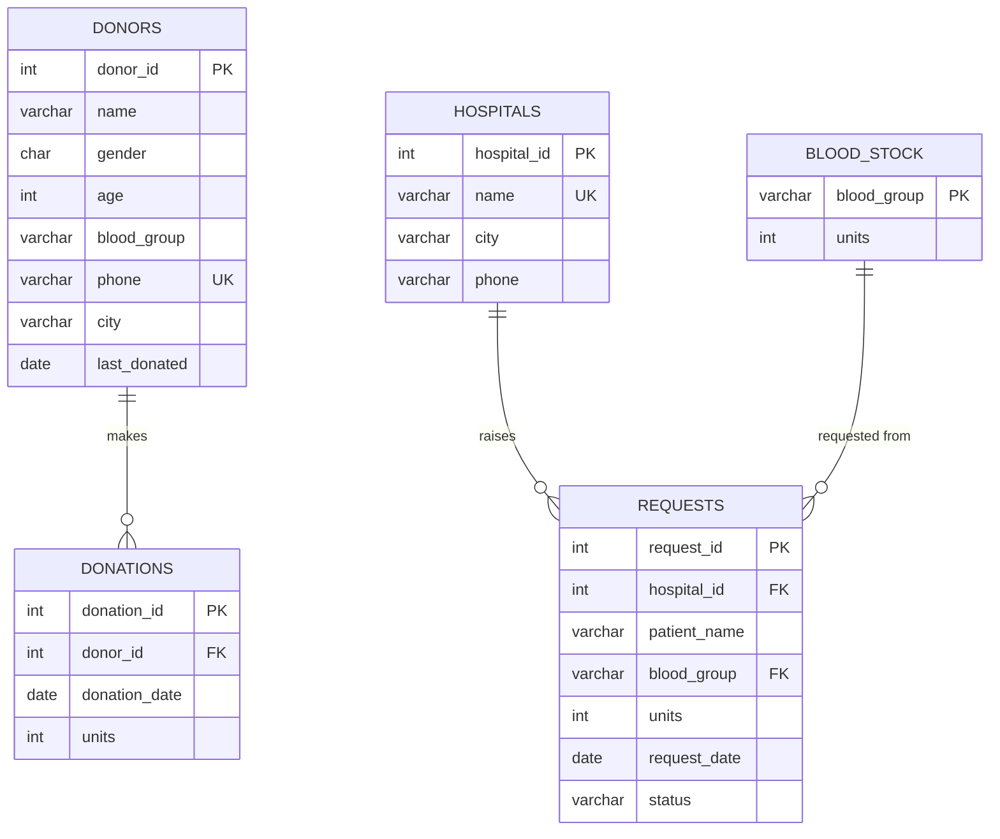

# 🩸 Blood Bank Management System

A simple DBMS mini-project to manage **blood donors, donations, blood stock and hospital requests**.
Most of the business rules are enforced **inside the database** with constraints, triggers and views,
and a small Flask web app sits on top.

**Tech stack:** Python (Flask) · SQLite · HTML/CSS

---

## Features

| Module       | What it does |
|--------------|--------------|
| Dashboard    | Total donors, hospitals and units, pending requests, stock per blood group (low stock is highlighted) |
| Donors       | Register donors, search by blood group and city, delete donors |
| Donations    | Record a donation. Stock is updated **automatically by a trigger** |
| Hospitals    | Add hospitals and see how many requests each one has made |
| Requests     | Hospitals request blood. Approve or reject; approval **deducts stock automatically** |
| Reports      | Live SQL reports (JOIN, GROUP BY, HAVING, subquery, view), with the query shown next to each result |

## How to run

```bash
pip install -r requirements.txt
python app.py
```
Open **http://127.0.0.1:5000**. The database (`bloodbank.db`) is created from `schema.sql` and `seed.sql`
the first time the app runs. To reset it, delete `bloodbank.db` and run the app again.

To try the SQL directly:
```bash
sqlite3 bloodbank.db < queries.sql
```

## Project structure
```
app.py            Flask routes
schema.sql        Tables, constraints, index, triggers, views
seed.sql          Sample data
queries.sql       Sample queries for demo/viva
templates/        HTML pages
static/style.css  Styling
```

---

## ER Diagram



## Tables

| Table | Primary key | Foreign keys | Main constraints |
|-------|-------------|--------------|------------------|
| `donors` | donor_id | – | age 18–65, valid blood group, 10-digit **unique** phone |
| `hospitals` | hospital_id | – | unique name, 10-digit phone |
| `blood_stock` | blood_group | – | units ≥ 0 |
| `donations` | donation_id | donor_id → donors | units 1–2 |
| `requests` | request_id | hospital_id → hospitals, blood_group → blood_stock | units 1–10, status ∈ {Pending, Approved, Rejected} |

## DBMS concepts used

| Concept | Where |
|---------|-------|
| **DDL** (CREATE, DROP) | `schema.sql` |
| **DML** (INSERT, UPDATE, DELETE, SELECT) | `seed.sql`, `app.py` |
| **Constraints**: PRIMARY KEY, FOREIGN KEY, UNIQUE, NOT NULL, CHECK, DEFAULT | all tables |
| **Referential integrity** (`ON DELETE RESTRICT`) | a donor with donations can't be deleted |
| **Triggers** | 5 triggers, listed below |
| **Views** | `v_donation_history`, `v_request_details`, `v_eligible_donors` |
| **Index** | `idx_donor_group_city`, for searching donors by group and city |
| **Joins** (INNER, LEFT) | Reports page, Hospitals page |
| **Aggregate functions + GROUP BY / HAVING** | Reports page |
| **Subqueries** | "Donors who never donated" report |
| **Transactions** (commit/rollback) | `run()` in `app.py` rolls back when a constraint or trigger fails |

### Triggers

| Trigger | Event | Purpose |
|---------|-------|---------|
| `trg_check_donation_gap` | BEFORE INSERT on donations | Blocks donations less than **90 days** apart |
| `trg_after_donation` | AFTER INSERT on donations | Adds units to `blood_stock` and updates `donors.last_donated` |
| `trg_check_stock` | BEFORE UPDATE on requests | Blocks approval if stock is **insufficient** |
| `trg_after_approve` | AFTER UPDATE on requests | Deducts approved units from `blood_stock` |
| `trg_lock_decided_request` | BEFORE UPDATE on requests | An approved or rejected request can't be changed again |

## Normalization

- **1NF**: every column holds a single atomic value and there are no repeating groups. For example, each donation is its own row in `donations` instead of a list stored inside `donors`.
- **2NF**: every table has a single-column primary key, so partial dependencies can't happen.
- **3NF**: no transitive dependencies. Hospital details are stored only in `hospitals`, and `requests` refers to them through `hospital_id`. A donation's blood group is not stored again; it comes from the donor through a join.

## Demo flow (for viva)

1. **Dashboard**: show the stock of each blood group.
2. **Donors**: add a donor with age 17. The CHECK constraint rejects it.
3. **Donations**: record a donation for *Arjun Kumar* (donated 40 days ago). The trigger blocks it.
   Record one for the donor you just added. That group's stock on the dashboard goes up.
4. **Requests**: approve request #4 (3 units of AB- when only 1 is in stock). The trigger blocks it.
   Approve request #2. The stock goes down.
5. **Reports**: walk through each SQL query and its output.
